<picture>
  <source media="(max-width: 600px) and (prefers-color-scheme: dark)" srcset="assets/banner-dark-tall.svg">
  <source media="(max-width: 600px)" srcset="assets/banner-light-tall.svg">
  <source media="(prefers-color-scheme: dark)" srcset="assets/banner-dark.svg">
  
</picture>

  <a href="https://danny-397.github.io"><b>Portfolio</b></a> &nbsp;·&nbsp;
  <a href="https://danny-397.github.io/reports.html"><b>Technical reports</b></a> &nbsp;·&nbsp;
  <a href="https://danny-397.github.io/reports/verification-ledger.html"><b>Verification ledger</b></a>

Six projects, built May to November 2026, each deployed to a URL you can open right now. Each one makes a claim with a number attached, and each has a test whose job is to break that claim. Three of them didn't beat their baseline, and they say so, with confidence intervals. Every figure below links back to how it was measured.

 

<a href="https://rl-for-crypto-and-stocks.vercel.app"><picture><source media="(max-width: 600px)" srcset="assets/01-rl-trader-tall.svg"></picture></a>

**[Live lab](https://rl-for-crypto-and-stocks.vercel.app)** · [Source](https://github.com/Danny-397/RL-for-Crypto-and-stocks-) · [Paper](https://danny-397.github.io/reports/rl-trader-paper.html) · [DOI 10.5281/zenodo.23843503](https://doi.org/10.5281/zenodo.23843503) &nbsp;—&nbsp; PyTorch, Gymnasium; predictions pre-registered before the runs, 505 tests

 

<a href="https://quantumsafescan.com"><picture><source media="(max-width: 600px)" srcset="assets/02-quantumsafe-tall.svg"></picture></a>

**[Scan your code](https://quantumsafescan.com)** · [Source](https://github.com/Danny-397/Quantum-Safe-Scan) · [PyPI](https://pypi.org/project/quantumsafe-scan/) · [GitHub Action](https://github.com/marketplace/actions/quantumsafe-scanner) · [Report](https://danny-397.github.io/reports/quantumsafe-technical-report.html) · [DOI](https://doi.org/10.5281/zenodo.23843488) &nbsp;—&nbsp; exports SARIF and CycloneDX CBOM; Shor's algorithm demonstrated in Qiskit

 

<a href="https://alphaglyph.org"><picture><source media="(max-width: 600px)" srcset="assets/03-alphaglyph-tall.svg"></picture></a>

**[Run a backtest](https://alphaglyph.org)** · [Source](https://github.com/Danny-397/Alphaglyph) · [Report](https://danny-397.github.io/reports/alphaglyph-technical-report.html) &nbsp;—&nbsp; Deflated Sharpe, CPCV, Fama-French; a 106k-parameter transformer served as ONNX in 512 MB

 

<a href="https://rlchess.xyz"><picture><source media="(max-width: 600px)" srcset="assets/04-chess-tall.svg"></picture></a>

**[Play the engine](https://rlchess.xyz/#play)** · [Source](https://github.com/Danny-397/RL-Chess-Engine) · [Report](https://danny-397.github.io/reports/rl-chess-technical-report.html) · [Experiments](https://danny-397.github.io/reports/rl-chess-experiment-results.html) &nbsp;—&nbsp; PUCT search, ResNet policy/value net, runs client-side in ONNX Runtime Web

 

<a href="https://www.tradeski.dev"><picture><source media="(max-width: 600px)" srcset="assets/05-tradeski-tall.svg"></picture></a>

**[Open the dashboard](https://www.tradeski.dev)** · [Source](https://github.com/Danny-397/Tradeski) · [Assistant eval](https://github.com/Danny-397/Tradeski/blob/main/docs/ski-eval/README.md) · [Report](https://danny-397.github.io/reports/tradeski-technical-report.html) &nbsp;—&nbsp; WebSockets, FRED macro data, Claude Haiku with nine tools and a check on every figure it quotes

 

<a href="https://danny-397.github.io/neural-canvas/"><picture><source media="(max-width: 600px)" srcset="assets/06-neural-canvas-tall.svg"></picture></a>

**[Paint with your hands](https://danny-397.github.io/neural-canvas/)** · [Source](https://github.com/Danny-397/neural-canvas) · [Report](https://danny-397.github.io/reports/neural-canvas-technical-report.html) &nbsp;—&nbsp; MediaPipe, one-euro filtering, six-fold symmetry, no build step

 

### How I work

- **Ship it.** A repository nobody can run isn't evidence of anything, so every project has a live URL.
- **Try to break the result before trusting it.** Held-out test sets are written before the fixes. Predictions are committed before the runs. AlphaGlyph exists mostly to attack my own backtests.
- **Report what the data said.** When a headline number doesn't survive more seeds or a fairer comparison, I withdraw it in public and keep the correction on the page.

### Outside my own repos

**[Farama-Foundation/Gymnasium#1657](https://github.com/Farama-Foundation/Gymnasium/pull/1657)**: I traced an `AsyncVectorEnv` crash on autoreset to scalar substitution in the worker, then wrote a fix and a regression test (+85/−3). I argued from `SyncVectorEnv`'s behaviour that it was a library bug. A maintainer closed it as an environment bug instead. I still think the two vector envs should behave the same, but it was their call, and learning that codebase well enough to make the case was worth it.

 

  <code>Python</code> · <code>PyTorch</code> · <code>NumPy</code> · <code>Flask</code> · <code>FastAPI</code> · <code>JavaScript</code> · <code>ONNX</code> · <code>Qiskit</code> · <code>Postgres</code> · <code>Docker</code> · <code>GitHub Actions</code>

Cards are generated by <a href="tools/build_cards.py"><code>tools/build_cards.py</code></a> from the figures in each project's own docs and CI.
