<picture>
  <source media="(max-width: 600px) and (prefers-color-scheme: dark)" srcset="assets/banner-dark-tall.svg">
  <source media="(max-width: 600px)" srcset="assets/banner-light-tall.svg">
  <source media="(prefers-color-scheme: dark)" srcset="assets/banner-dark.svg">
  
</picture>

  <a href="https://danny-397.github.io"><b>Portfolio</b></a> &nbsp;·&nbsp;
  <a href="https://danny-397.github.io/reports.html"><b>Technical reports</b></a> &nbsp;·&nbsp;
  <a href="https://danny-397.github.io/reports/verification-ledger.html"><b>Verification ledger</b></a>

I build software end to end, from the model or algorithm to the backend to the site you can open, and then I measure whether it works. Six projects, all live: a post-quantum security scanner published on PyPI, a deep reinforcement learning study with a paper and a DOI, a real-time market dashboard with an AI assistant, a backtesting lab, a chess engine that teaches itself, and a hand-tracking art tool. Each one has its own test suite running in CI and a technical report.

 

<a href="https://quantumsafescan.com"><picture><source media="(max-width: 600px)" srcset="assets/01-quantumsafe-tall.svg"></picture></a>

**[Scan your code](https://quantumsafescan.com)** · [Source](https://github.com/Danny-397/Quantum-Safe-Scan) · [PyPI](https://pypi.org/project/quantumsafe-scan/) · [GitHub Action](https://github.com/marketplace/actions/quantumsafe-scanner) · [Report](https://danny-397.github.io/reports/quantumsafe-technical-report.html) · [DOI](https://doi.org/10.5281/zenodo.23843488) &nbsp;—&nbsp; exports SARIF and CycloneDX CBOM; Shor's algorithm demonstrated in Qiskit

 

<a href="https://rl-for-crypto-and-stocks.vercel.app"><picture><source media="(max-width: 600px)" srcset="assets/02-rl-trader-tall.svg"></picture></a>

**[Live lab](https://rl-for-crypto-and-stocks.vercel.app)** · [Source](https://github.com/Danny-397/RL-for-Crypto-and-stocks-) · [Paper](https://danny-397.github.io/reports/rl-trader-paper.html) · [DOI 10.5281/zenodo.23843503](https://doi.org/10.5281/zenodo.23843503) &nbsp;—&nbsp; PPO in PyTorch and Gymnasium; predictions pre-registered before the runs; beats a tuned textbook hedge when trading costs are high

 

<a href="https://www.tradeski.dev"><picture><source media="(max-width: 600px)" srcset="assets/03-tradeski-tall.svg"></picture></a>

**[Open the dashboard](https://www.tradeski.dev)** · [Source](https://github.com/Danny-397/Tradeski) · [Assistant eval](https://github.com/Danny-397/Tradeski/blob/main/docs/ski-eval/README.md) · [Report](https://danny-397.github.io/reports/tradeski-technical-report.html) &nbsp;—&nbsp; WebSockets, FRED macro data, Claude Haiku with nine tools and a check on every figure it quotes

 

<a href="https://alphaglyph.org"><picture><source media="(max-width: 600px)" srcset="assets/04-alphaglyph-tall.svg"></picture></a>

**[Run a backtest](https://alphaglyph.org)** · [Source](https://github.com/Danny-397/Alphaglyph) · [Report](https://danny-397.github.io/reports/alphaglyph-technical-report.html) &nbsp;—&nbsp; Deflated Sharpe, CPCV, Fama-French factor models, options analytics

 

<a href="https://rlchess.xyz"><picture><source media="(max-width: 600px)" srcset="assets/05-chess-tall.svg"></picture></a>

**[Play the engine](https://rlchess.xyz/#play)** · [Source](https://github.com/Danny-397/RL-Chess-Engine) · [Report](https://danny-397.github.io/reports/rl-chess-technical-report.html) · [Experiments](https://danny-397.github.io/reports/rl-chess-experiment-results.html) &nbsp;—&nbsp; PUCT search, ResNet policy/value net, runs in your browser with ONNX Runtime Web

 

<a href="https://danny-397.github.io/neural-canvas/"><picture><source media="(max-width: 600px)" srcset="assets/06-neural-canvas-tall.svg"></picture></a>

**[Paint with your hands](https://danny-397.github.io/neural-canvas/)** · [Source](https://github.com/Danny-397/neural-canvas) · [Report](https://danny-397.github.io/reports/neural-canvas-technical-report.html) &nbsp;—&nbsp; MediaPipe, one-euro filtering, six-fold symmetry, no build step

 

### How I work

- **Ship it.** Every project runs at a live URL, with tests on every commit.
- **Measure it.** Held-out test sets, many independent training runs, confidence intervals, and predictions written down before the experiment.
- **Write it up.** Every project has a technical report explaining how it works and how each number was measured.

### Open source

**[Farama-Foundation/Gymnasium#1657](https://github.com/Farama-Foundation/Gymnasium/pull/1657)**: traced an `AsyncVectorEnv` crash on autoreset to how the worker process substitutes scalar values, then submitted a fix with a regression test and worked through the design question with the library's maintainers.

 

  <code>Python</code> · <code>PyTorch</code> · <code>NumPy</code> · <code>Flask</code> · <code>FastAPI</code> · <code>JavaScript</code> · <code>ONNX</code> · <code>Qiskit</code> · <code>Postgres</code> · <code>Docker</code> · <code>GitHub Actions</code>

Cards are generated by <a href="tools/build_cards.py"><code>tools/build_cards.py</code></a> from the figures in each project's own docs and CI.
